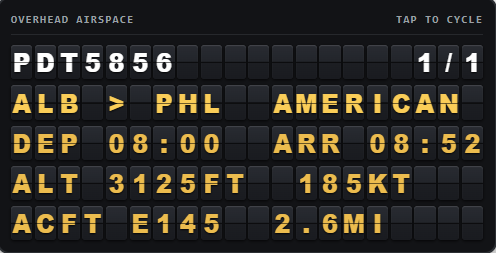

# Overhead Split-Flap Radar Card

A mechanical airport-style split-flap (Solari) Lovelace card for Home Assistant that displays live aircraft flying over your home.



## Supported Integrations & Required Entities

This card is a **frontend dashboard card**, it reads flight telemetry from existing Home Assistant flight-tracking integrations rather than polling external APIs directly.

You need **at least one** of the following HACS integrations installed and configured for your home coordinates:

### 1. Flightradar24 (Recommended for Commercial Routes & Schedules)
* **Integration:** [AlexandrErohin/home-assistant-flightradar24](https://github.com/AlexandrErohin/home-assistant-flightradar24)
* **Entity to use:** `sensor.flightradar24_current_in_area`
* **What it provides:** Callsign, airline, origin/destination airport codes, scheduled/estimated departure and arrival times, aircraft type, altitude, speed, and distance.

### 2. adsb.lol / Nearby Aircraft (Recommended for Unfiltered / Private Traffic)
* **Integration:** [matthewgall/homeassistant-nearbyaircraft](https://github.com/matthewgall/homeassistant-nearbyaircraft)
* **Entity to use:** Your `ADSB Nearby` list sensor or single `Nearest Aircraft` sensor.
* **What it provides:** Unfiltered ADS-B transponder data including private/LADD-blocked tail numbers, military aircraft, squawk codes, aircraft type, altitude, speed, heading, and distance. *(Note: Raw ADS-B feeds do not include origin/destination airports or scheduled times.)*

### 3. Hybrid Mode (Best of Both Worlds)
If you run **both** integrations, set `entity` to your Flightradar24 sensor and `adsb_entity` to your `adsb.lol` sensor. Whenever Flightradar24 masks a private jet as `BLOCKED` (FAA LADD filtering), the card automatically cross-references `adsb.lol` to display the real tail number while keeping full route and schedule data for commercial flights.

> **Future Integration Support:** Support for additional flight and local ADS-B integrations, including **OpenSky Network**, **airplanes.live**, **adsb.fi**, and local **`dump1090` / `readsb`** receivers, is planned for future releases.

---

## Installation

### Via HACS (Custom Repository)
1. Open **HACS** in Home Assistant.
2. Click the three dots (`⋮`) in the top right corner and select **Custom repositories**.
3. Paste your GitHub repository URL (`https://github.com/jdaleo23/ha-overhead-splitflap-card`).
4. Select **Dashboard** as the category and click **Add**.
5. Search for **Overhead Split-Flap Radar Card** in HACS and click **Download**.
6. Refresh your browser or mobile app.

### Manual Installation
1. Download `overhead-splitflap-card.js` from the latest release.
2. Copy it to `/config/www/overhead-splitflap-card.js`.
3. Add `/local/overhead-splitflap-card.js` as a **JavaScript Module** under **Settings → Dashboards → Resources**.

---

## Configuration

Add the card to any dashboard view using the manual card editor:

```yaml
type: custom:overhead-splitflap-card
entity: sensor.flightradar24_current_in_area
adsb_entity: sensor.adsb_nearby_nearest_aircraft # Optional
title: OVERHEAD AIRSPACE
columns: 20
cycle_seconds: 12
```

### Options

| Option | Type | Default | Description |
| :--- | :--- | :--- | :--- |
| `entity` | string | **Required** | Primary flight sensor (`sensor.flightradar24_current_in_area` or an `adsb.lol` sensor). |
| `adsb_entity` | string | `null` | Optional `adsb.lol` sensor used to unmask LADD-blocked flights when using Flightradar24. |
| `title` | string | `OVERHEAD RADAR` | Header text displayed in the top-left corner of the board. |
| `columns` | number | `20` | Number of split-flap character tiles per row. |
| `cycle_seconds` | number | `12` | Seconds before auto-cycling to the next overhead aircraft (`0` disables auto-cycle). |
| `flip_speed_ms` | number | `45` | Animation speed in milliseconds per character flip step. |

---

## Roadmap & Planned Features

* **Visual Card Editor:** Native Lovelace UI configuration editor (`getConfigElement`) so entities and settings can be selected without YAML.
* **Custom Themes & Colors:** Configurable tile background colors, hinge styles, and per-row text color presets (classic amber, crisp white, emerald radar green, or custom hex codes).
* **Customizable Rows & Field Toggles:** Ability to reorder rows, adjust row counts, and include or exclude specific telemetry fields (e.g., squawk code, vertical speed, heading, or registration).
* **Configurable Timing Controls:** Independent controls for cycle intervals, animation cascade delays, and idle board behavior when airspace is empty.
* **Optional Mechanical Sound Effects:** Toggleable synthesized split-flap clacking audio when tiles flip.
* **Expanded Data Sources:** Native attribute parsers for OpenSky Network and local RTL-SDR (`readsb` / `dump1090`) sensors.
