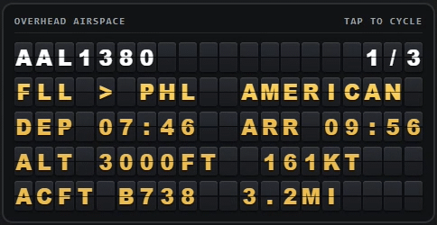

[](https://github.com/jdaleo23/ha-overhead-splitflap-card/releases)
[](https://github.com/hacs/integration)


[](https://paypal.me/jordandaleo)
[](https://ko-fi.com/jdaleo23)

# Overhead Split-Flap Radar Card

A mechanical airport-style split-flap (Solari) Lovelace card for Home Assistant that displays live aircraft flying over your home.



## Required & Optional Integrations

This card is a **frontend dashboard card**. It reads flight data from existing Home Assistant integrations rather than polling external APIs directly.

### 1. Flightradar24 (Required)
- **Integration:** [AlexandrErohin/home-assistant-flightradar24](https://github.com/AlexandrErohin/home-assistant-flightradar24)
- **Entity to use:** `sensor.flightradar24_current_in_area` *(Friendly name: **Current in area**)*
- **What it provides:** Every row of the board for the vast majority of traffic: callsign, airline, origin/destination, scheduled/estimated departure and arrival times, aircraft type, altitude, speed, and distance.
- **If it is unavailable:** the board shows `FR24 FEED OFFLINE` instead of partial or mismatched data.

### 2. ADS-B Nearby, Nearest Aircraft (Optional LADD Add-On)
- **Integration:** [matthewgall/homeassistant-nearbyaircraft](https://github.com/matthewgall/homeassistant-nearbyaircraft)
- **Entity to use:** `sensor.adsb_nearby_..._nearest_aircraft` *(Friendly name: **Nearest Aircraft**)*
- **What it does:** Flightradar24 hides some private jets and helicopters (FAA LADD filtering) and reports them as `BLOCKED`. When `adsb_entity` is set, the card cross-references each blocked flight against your `Nearest Aircraft` list (ICAO aircraft type, GPS proximity, heading, and altitude/speed bands) and shows the real callsign or tail number, for example `LXJ337 (LADD)`. If no match is found it shows `LADD BLOCKED`.
- **What it does not do:** ADS-B transponders do not broadcast routes, airlines, or schedules, so ADS-B only ever fills in the callsign. Every other row always comes from Flightradar24.

> **Always select `Nearest Aircraft` (`*_nearest_aircraft`)**, not `Closest Aircraft` or `Aircraft in Range`.
> `Nearest Aircraft` exposes a ranked list of **all** aircraft in your radius (`aircraft_1`, `aircraft_2`, ...), so a blocked jet can still be matched when an airliner is closer. `Closest Aircraft` only holds a single plane.

> **Tip:** Set the same radius in both integrations for the best match rate. Flightradar24's radius is in meters (for example `8047` m is about 5 miles).

> **Rate limits:** Both data services limit how often they can be polled, and the limits can change. If a sensor goes `unavailable` with HTTP 429 errors in your Home Assistant log, increase the integration's update interval or choose a different data source. See the [adsb.lol API documentation](https://www.adsb.lol/docs/open-data/api) and the [Flightradar24 integration notes](https://github.com/AlexandrErohin/home-assistant-flightradar24) for current limits.

### What Each Row Shows

| Row | Content | Source |
| :--- | :--- | :--- |
| 1 | Callsign + rotation counter (`AAL1380    1/3`) | Flightradar24 (ADS-B fills in blocked callsigns) |
| 2 | `ORG > DST  AIRLINE` (`--- > ---  PRIVATE` when unknown) | Flightradar24 |
| 3 | `DEP HH:MM  ARR HH:MM` (`--:--` when unknown) | Flightradar24 |
| 4 | `ALT 3000FT  161KT` (`GND` on the ground, `---` if unknown) | Flightradar24 |
| 5 | `ACFT B738  3.2MI` (`KM` if your Home Assistant uses metric) | Flightradar24 |

The layout is identical for every aircraft, so the board never shifts between commercial, private, and unscheduled flights.

> **Upgrading from v1.3.x:** `entity` must now be your Flightradar24 sensor. Pointing it at an ADS-B sensor is no longer supported and the board will show `FR24 FEED OFFLINE`. Put your ADS-B `Nearest Aircraft` sensor in `adsb_entity` instead.

> **Future Integration Support:** Support for additional local ADS-B sources for LADD unmasking, including **airplanes.live**, **adsb.fi**, and local **`dump1090` / `readsb`** receivers, is planned for future releases.

---
## Installation

### Via HACS
1. Open **HACS** in Home Assistant and search for **Overhead Split-Flap Radar Card**.
2. Click **Download**.
3. Refresh your browser (`Ctrl+Shift+R` / `Cmd+Shift+R`) or clear cache in the Home Assistant Companion App.

### Manual Installation
1. Download `overhead-splitflap-card.js` from the [latest release](https://github.com/jdaleo23/ha-overhead-splitflap-card/releases/latest).
2. Copy it to `/config/www/overhead-splitflap-card.js`.
3. Add `/local/overhead-splitflap-card.js` as a **JavaScript Module** under **Settings → Dashboards → Resources**.

---

## Configuration

### Visual Card Editor (Recommended)
1. Open your dashboard, click **Edit Dashboard** (pencil icon), and select **+ Add Card**.
2. Search for **Overhead Split-Flap Radar Card** and click it.
3. Choose your entities from the dropdown menus and adjust your board settings visually, no YAML required:

| Field | Value |
| :--- | :--- |
| **Flightradar24 Sensor** (`entity`) | `sensor.flightradar24_current_in_area` *(required)* |
| **ADS-B Nearest Aircraft Sensor** (`adsb_entity`) | `sensor.adsb_nearby_..._nearest_aircraft` *(optional, enables LADD unmasking)* |
### YAML Configuration
If you prefer YAML, add the card using the manual card editor:

```yaml
type: custom:overhead-splitflap-card
entity: sensor.flightradar24_current_in_area
adsb_entity: sensor.adsb_nearby_nearest_aircraft # Optional: unmasks LADD-blocked flights
title: OVERHEAD AIRSPACE
columns: 20
cycle_seconds: 12
flip_speed_ms: 45
```

### Options

| Option | Type | Default | Description |
| :--- | :--- | :--- | :--- |
| `entity` | string | **Required** | Your Flightradar24 `Current in area` sensor (`sensor.flightradar24_current_in_area`). |
| `adsb_entity` | string | `null` | Optional ADS-B `*_nearest_aircraft` sensor used to unmask LADD-blocked Flightradar24 flights. |
| `title` | string | `OVERHEAD RADAR` | Header text displayed in the top-left corner of the board. |
| `columns` | number | `20` | Number of split-flap character tiles per row (`14`-`32`). |
| `cycle_seconds` | number | `12` | Seconds before auto-cycling to the next overhead aircraft (`0` disables auto-cycle). |
| `flip_speed_ms` | number | `45` | Animation speed in milliseconds per character flip step (`15`-`150`). |

---

## Roadmap & Planned Features

- **Custom Themes & Colors:** Configurable tile background colors, hinge styles, and per-row text color presets (classic amber, crisp white, emerald radar green, or custom hex codes).
- **Customizable Rows & Field Toggles:** Ability to reorder rows, adjust row counts, and include or exclude specific telemetry fields (e.g., squawk code, vertical speed, heading, or registration).
- **Configurable Timing Controls:** Independent controls for cycle intervals, animation cascade delays, and idle board behavior when airspace is empty.
- **Optional Mechanical Sound Effects:** Toggleable synthesized split-flap clacking audio when tiles flip.
- **Expanded LADD Sources:** Additional ADS-B sources (airplanes.live, adsb.fi, local `readsb` / `dump1090`) for unmasking blocked aircraft.
